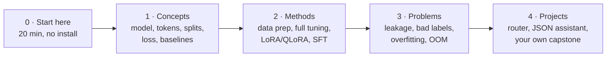
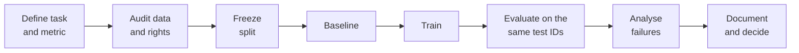

<div align="center">

# Fine-Tuning from Zero

**An open, honest, end-to-end course on fine-tuning language models: from "what is a weight?" to a reproducible, evaluated LoRA adapter.**

[](https://github.com/geek007git/fine-tuning-from-zero/actions/workflows/checks.yml)
[](https://colab.research.google.com/github/geek007git/fine-tuning-from-zero/blob/main/labs/colab_labs.ipynb)
[](LICENSE-CONTENT.md)
[](LICENSE)


**Concepts → Methods → Problems → Projects**

[Start learning](en/00_start_here.md) · [Course map](COURSE_MAP.md) · [Labs](labs/README.md) · [Glossary](en/GLOSSARY.md) · [Workbook](en/05_workbook.md)

</div>

---

## Why this course?

Most fine-tuning tutorials end when `trainer.train()` finishes. This one doesn't, because a finished training run tells you nothing about whether the model is any better. Here you learn to:

- **Decide whether to fine-tune at all.** A prompt, a rule or retrieval often wins, and you'll learn to show that with evidence.
- **Build a dataset that doesn't lie to you.** Group splits, leakage audits and label policies.
- **Train two ways:** full fine-tuning of a small classifier and a **LoRA adapter** on a small chat model.
- **Evaluate fairly.** The same frozen test IDs, per-class metrics, raw predictions and paired comparisons.
- **Debug failures** using a clinic of 12+ realistic incidents.
- **Ship something reproducible:** a dataset card, a model card and a fresh-process reload.

Every lesson follows the **Feynman pattern**: plain story → precise explanation → failure case → *teach-back* question.

## Who is it for?

| You are… | Your route | GPU needed? |
| --- | --- | --- |
| 🎓 **A student** who knows a little Python | [Student route](audiences/STUDENTS.md) | No. The whole conceptual path and first lab need only Python. |
| 🛠️ **A working engineer** with a real task | [Engineer route](audiences/ENGINEERS.md): decision gates for production | Helpful, not required |
| 🧑‍🏫 **An instructor or professor** | [Instructor route](audiences/INSTRUCTORS.md): 1-day, 4-week and 12-week plans with rubrics | Optional (Colab works) |

## The learning path



| # | Phase | Read | Practise | Go deeper |
| --- | --- | --- | --- | --- |
| 0 | **Start here** | [What is fine-tuning?](en/00_start_here.md) | [Exercise: choose a method](exercises/01_choose_the_method.md) | — |
| 1 | **Concepts** (Ch. 1–5) | [Part 1](en/01_concepts.md) | [Workbook C1–C6](en/05_workbook.md#concepts-diagnose-the-task) | [Worked concepts](mastery/01_concepts_worked.md) · [Math without fear](mastery/05_math_without_fear.md) |
| 2 | **Methods** (Ch. 6–11) | [Part 2](en/02_methods.md) | [Workbook M1–M6](en/05_workbook.md#methods-choose-and-explain-the-training-plan) · [Labs 1–3](labs/README.md) | [Worked methods](mastery/02_methods_worked.md) |
| 3 | **Problems** (Ch. 12–16) | [Part 3](en/03_problems.md) | [Workbook P1–P6](en/05_workbook.md#problems-debug-failures) | [Worked problems](mastery/03_problems_worked.md) |
| 4 | **Projects** | [Part 4](en/04_projects.md) | [Workbook J1–J6](en/05_workbook.md#projects-judge-a-completed-system) | [Worked projects](mastery/04_projects_worked.md) · [Mastery pathway](mastery/06_mastery_pathway.md) |

Reference while you work: [Glossary](en/GLOSSARY.md) · [Trusted resources & papers](RESOURCES.md) · [Dataset card template](templates/DATASET_CARD.md) · [Model card template](templates/MODEL_CARD.md)

## Quick start

**No install (2 minutes).** You need only Python 3.10 or newer:

```bash
git clone https://github.com/geek007git/fine-tuning-from-zero.git
cd fine-tuning-from-zero/labs
python audit_and_baseline.py        # audit the toy dataset + keyword baseline
```

**Full labs: fine-tune a classifier and a LoRA adapter.** Run locally (see [lab setup](labs/README.md#0-create-an-isolated-environment)) or in the browser with a free GPU:

[](https://colab.research.google.com/github/geek007git/fine-tuning-from-zero/blob/main/labs/colab_labs.ipynb)

## The running example

One fictional task grows through the whole course: routing support tickets to `billing`, `technical` or `account`.



Here is what the labs actually produce. These are real outputs from a CPU run of this repository; see [labs/README.md](labs/README.md#verified-reference-run) for versions and settings:

```text
$ python compare_predictions.py runs/baseline/test_predictions.jsonl runs/classifier/test_predictions.jsonl
id       label      before     after      change
acc-11   account    billing    account    FIXED
acc-12   account    account    billing    BROKEN
bil-11   billing    account    billing    FIXED
tec-12   technical  billing    technical  FIXED
tec-13   technical  technical  account    BROKEN

n = 15: before 12/15 correct, after 13/15 correct
```

The fine-tuned model looks like an "80% → 87%" improvement. Really, it fixed three tickets and broke two, a net change of **one ticket out of 15**. Learning to see that difference is the point of this course.

## Repository layout

```text
.
├── en/                 Core course (English, authoritative)
│   ├── 00_start_here.md    Lesson 0: what is fine-tuning?
│   ├── 01_concepts.md      Part 1: Chapters 1–5
│   ├── 02_methods.md       Part 2: Chapters 6–11
│   ├── 03_problems.md      Part 3: Chapters 12–16
│   ├── 04_projects.md      Part 4: three projects + 100-point rubric
│   ├── 05_workbook.md      24 exercises with worked answers
│   └── GLOSSARY.md
├── mastery/            Slower worked lab books, math, mastery checkpoints
├── audiences/          Student, engineer and instructor routes
├── exercises/          Short standalone exercises
├── labs/               Runnable code, toy data, Colab notebook
├── templates/          Dataset card and model card
├── docs/               Maintainer docs (review brief)
├── COURSE_MAP.md       Outcomes, pacing, prerequisites
└── RESOURCES.md        Primary documentation and papers
```

## Principles

1. **No invented numbers.** Every metric in this repo comes from a run that was actually done, with its versions and hardware stated. The toy dataset has 45 fictional tickets. It teaches the mechanics and proves nothing about production quality.
2. **The simpler baseline is a valid answer.** If a keyword rule or prompt meets the requirement, that is good engineering, not a failed project.
3. **The test set is sacred.** Use validation for decisions and test once. If you look at test errors and change things, collect a fresh test.

## Translations

English is the reference text. **Tamil and Hindi** editions are planned and will follow the reviewed English core. Contributions are welcome (see below).

## Contributing

Found an error, a confusing paragraph or a lab that breaks on new library versions? Please [open an issue](https://github.com/geek007git/fine-tuning-from-zero/issues/new/choose) or a pull request. Read [CONTRIBUTING.md](CONTRIBUTING.md) first; the one hard rule is: **never add a metric you didn't measure.**

## License

- Course text, templates and toy data: [CC BY 4.0](LICENSE-CONTENT.md). Reuse and adapt freely, with credit.
- Code in `labs/`: [MIT](LICENSE).
- External models (DistilBERT, Qwen2.5) and libraries keep their own licenses.
